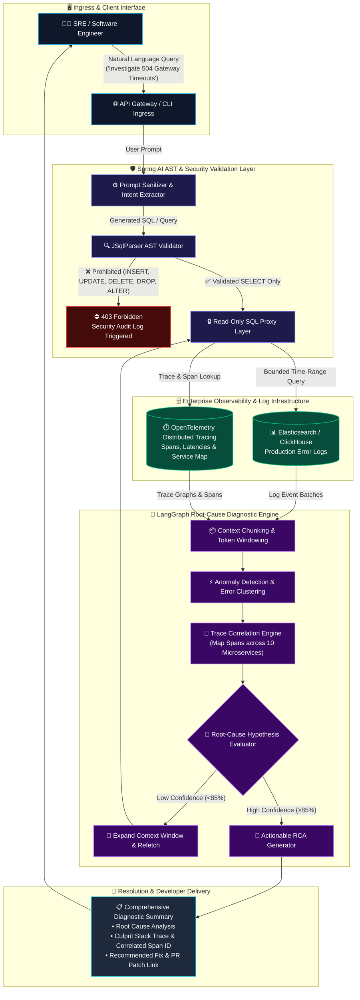
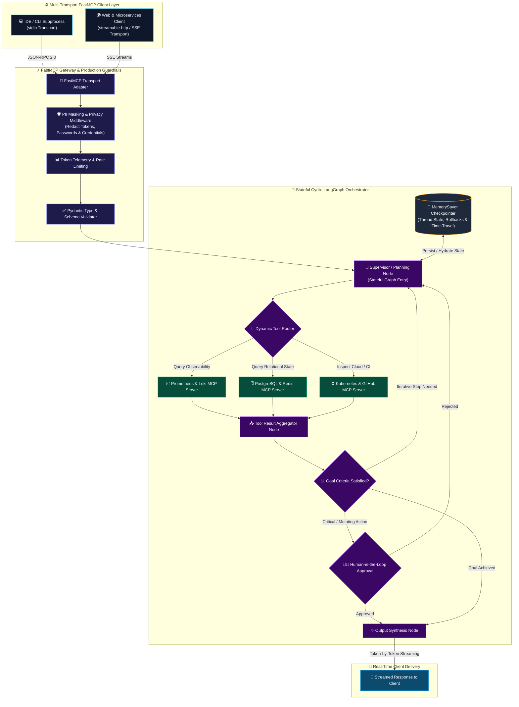
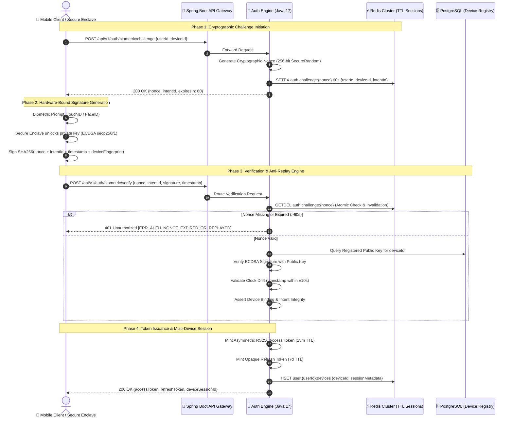

<!-- Animated Header Banner -->

  

<!-- Animated Typing Subheader -->

 

<!-- Profile Social Badges -->

---

### 🚀 About Me

I am a **Software Engineer** specializing in **Java, Spring Boot, microservices architecture, and Agentic AI**. With hands-on experience building enterprise-grade authentication, onboarding, loyalty, and AI-enabled observability systems, I focus on building distributed backend solutions that scale with resilience, strict security, and high performance.

- 💼 **Software Engineer at [Salescode AI](https://salescode.ai)** (Oct 2025 – Sept 2026):
  - Engineered production Java/Spring Boot microservices and REST APIs for authentication, onboarding, and secure service-to-service communication.
  - Implemented **OAuth 2.0 & SSO** with token issuance, refresh/revocation, and session validation across **10 services**.
  - Built an **Authentication Configuration Portal** adopted by 10 LOBs, enabling zero-downtime self-service config of login/password policies and OTP providers.
  - Designed and deployed a custom **cryptographic biometric authentication system** (RSA & ECDSA) featuring two-phase challenge-response, device binding, and TTL-based intent validation.
  - Architected **OpenTelemetry distributed tracing and structured logging** across 7 enterprise clients, cutting onboarding time down to ~2 hours.
- 🧠 **AI & Agentic Systems**: Building autonomous, tool-calling agents with **Spring AI**, **LangGraph**, **LangChain**, and **FastMCP (Model Context Protocol)**.
- 🏆 **Problem Solving & DSA**: **LeetCode Rating: 1812** | **600+ problems solved on LeetCode** | **1,200+ problems** across competitive programming platforms.
- 🎓 **Education**: B.Tech in Computer Science & Engineering from **ABES Engineering College** (CGPA: 8.02/10).
- 🏅 **Honors**: Recipient of the prestigious **National Means-cum-Merit Scholarship**.

---

### 🛠️ Technical Arsenal

| Domain | Technologies & Frameworks |
| :--- | :--- |
| **Languages** |      |
| **Backend & Microservices** |      |
| **AI, GenAI & Agents** |     |
| **Databases & Caching** |     |
| **Observability & Security** |    |
| **DevOps & Cloud** |      |

---

### 🌟 Featured Projects

  

<table>
  <tr>
    <td width="50%" valign="top">
      

        <h3>🤖 AI-Powered Log Investigation System</h3>
        

          
          
        

        

          
          
          
          
        

      

      <ul>
        <li>Developed an enterprise AI diagnostic engine enabling engineers to analyze production error logs through natural-language queries.</li>
        <li>Implemented a controlled read-only log pipeline providing contextual traces to LLMs for root-cause failure analysis.</li>
        <li>Enforced a strict <b>SQL security proxy layer</b> restricting AI database execution strictly to <code>SELECT</code> queries.</li>
      </ul>
      

        
<b>🔍 System Architecture &amp; Data Pipeline</b>

         
        <blockquote>
          <code>Natural Language Query</code> ➔ <code>Spring AI AST Validator</code> ➔ <code>Read-Only SQL Proxy</code> ➔ <code>LangGraph Root-Cause Synthesizer</code>
        </blockquote>
      

       
      

        
      

    </td>
    <td width="50%" valign="top">
      

        <h3>⚡ Agentic AI Ecosystem</h3>
        

          
          
        

        

          
          
          
          
        

      

      <ul>
        <li>Orchestrated stateful cyclic agent graphs with <code>MemorySaver</code> checkpointing and dynamic tool routing.</li>
        <li>Architected a multi-transport <b>Model Context Protocol (FastMCP)</b> gateway connecting <code>stdio</code> subprocesses and <code>streamable-http</code> servers concurrently.</li>
        <li>Built production middleware for PII masking, token telemetry, guardrails, and Pydantic validation.</li>
      </ul>
      

        
<b>🔍 Gateway Architecture &amp; Tool Routing</b>

         
        <blockquote>
          <code>stdio / HTTP Client</code> ➔ <code>FastMCP Transport Gateway</code> ➔ <code>Cyclic Agent Graph</code> ➔ <code>PII Masking &amp; Token Telemetry</code>
        </blockquote>
      

       
      

        
      

    </td>
  </tr>
  <tr>
    <td width="50%" valign="top">
      

        <h3>🎟️ BarterNow: AI Sponsorship Platform</h3>
        

          
          
        

        

          
          
          
          
        

      

      <ul>
        <li>Two-sided marketplace connecting brands with event organizers using an AI-driven demographic recommendation engine.</li>
        <li>Engineered reliable payment settlement with <b>idempotent webhook handling</b> via Razorpay and real-time ROI analytics.</li>
      </ul>
      

        
<b>🔍 Event Processing &amp; Settlement Flow</b>

         
        <blockquote>
          <code>Event Demographics</code> ➔ <code>AI Recommendation Engine</code> ➔ <code>Webhook Consumer</code> ➔ <code>Idempotent Ledger Settlement</code>
        </blockquote>
      

       
      

        
      

    </td>
    <td width="50%" valign="top">
      

        <h3>🔐 Biometric &amp; Multi-Device Auth Engine</h3>
        

          
          
        

        

          
          
          
          
        

      

      <ul>
        <li>Cryptographic challenge-response biometric flow with single-use intents, device binding, and TTL-based expiry across 15 typed error states.</li>
        <li>Multi-device concurrent session management with granular device-level token revocation.</li>
      </ul>
      

        
<b>🔍 Challenge-Response Cryptographic Flow</b>

         
        <blockquote>
          <code>Client Device</code> ➔ <code>Nonce Challenge</code> ➔ <code>Hardware Signature (ECDSA)</code> ➔ <code>Intent Verification &amp; TTL Session</code>
        </blockquote>
      

       
      

        
      

    </td>
  </tr>
</table>

---

### 🏗️ Deep-Dive Architecture & System Flows

  
Production architectural blueprints detailing end-to-end data pipelines, state machines, and cryptographic protocols.

 

#### 🤖 1. AI-Powered Production Log Investigation Engine
> **Enterprise Problem**: Diagnosing multi-service production outages across distributed logs and traces typically requires hours of manual grep, log querying, and correlation across siloed tools.  
> **Engineered Solution**: An autonomous diagnostic pipeline combining a **Spring AI AST query validator**, an enforced **read-only SQL proxy**, and a **LangGraph root-cause synthesis agent** with confidence-based iterative retrieval.

<table>
  <tr>
    <td width="33%"><b>🔒 Zero-Risk Read-Only Proxy</b> Enforces strict <code>SELECT</code> queries via JSqlParser AST analysis; immediately terminates and audits any data mutation attempts.</td>
    <td width="33%"><b>🔗 OpenTelemetry Span Correlation</b> Unifies unstructured stack traces with distributed trace contexts across 10 microservices to isolate upstream cascade failures.</td>
    <td width="33%"><b>🧪 Cyclic Hypothesis Loop</b> Evaluates diagnosis confidence: triggers secondary targeted log fetches if under 85% before presenting actionable remediation.</td>
  </tr>
</table>

 

#### ⚡ 2. Autonomous Agentic AI Ecosystem (FastMCP & LangGraph)
> **Enterprise Problem**: Monolithic LLM wrappers struggle with non-deterministic execution, lack state persistence across multi-turn sessions, and risk leaking sensitive data (PII/secrets) to models.  
> **Engineered Solution**: A decoupled **Model Context Protocol (FastMCP)** gateway supporting both `stdio` and `streamable-http` transports with inline privacy filters, powering a cyclic **LangGraph** orchestrator with **MemorySaver** checkpointing and Human-in-the-Loop governance.

<table>
  <tr>
    <td width="33%"><b>🔌 Dual Transport Gateway</b> Concurrently serves local CLI subagents (stdio) and remote web microservices (streamable-http/SSE) through normalized MCP JSON-RPC.</td>
    <td width="33%"><b>💾 MemorySaver Checkpointing</b> Preserves serialized agent state at every node transition, enabling thread-based state resumption and zero-loss error rollbacks.</td>
    <td width="33%"><b>🧑‍💼 Human-in-the-Loop (HITL)</b> Halts agent graph execution on high-impact tools (e.g. database migration or cluster restart) pending human confirmation.</td>
  </tr>
</table>

 

#### 🔐 3. Zero-Trust Biometric & Multi-Device Auth Engine
> **Enterprise Problem**: Password-based and SMS OTP authentication are prone to SIM swapping, replay attacks, and token interception, while monolithic session storage fails under multi-device concurrency.  
> **Engineered Solution**: A **hardware-bound cryptographic challenge-response authentication engine** using **RSA & ECDSA (secp256r1)**, single-use Redis nonces with TTL expiration, atomic `GETDEL` replay prevention, and multi-device session management.

<table>
  <tr>
    <td width="33%"><b>🔑 Hardware-Bound Security</b> Private keys never leave the device's Secure Enclave / Android StrongBox; signatures prove physical hardware possession.</td>
    <td width="33%"><b>⚡ Atomic Anti-Replay Defense</b> Redis <code>GETDEL</code> ensures nonces are single-use and invalid immediately upon lookup, stopping replay attacks cold.</td>
    <td width="33%"><b>📱 Multi-Device Concurrent Sessions</b> Maintains independent token lifecycles per device; enables users to remotely revoke compromised devices without logging out of others.</td>
  </tr>
</table>

 

#### 🎟️ 4. BarterNow: AI Sponsorship & Idempotent Settlement Engine
> **Enterprise Problem**: Webhook network retries and asynchronous payment events often result in duplicate ledger credits or race conditions in two-sided sponsorship deals.  
> **Engineered Solution**: An **idempotent settlement pipeline** utilizing Razorpay webhook cryptographic signature verification, atomic Redis idempotency locks, and transactional database ledger entries.

```mermaid
flowchart LR
    Event["🎪 Event Demographics\n& Pitch Details"] --> RecEngine["🤖 AI Demographic\nRecommendation Engine"]
    RecEngine --> BrandMatch["🏢 Brand Match &\nProposal Generation"]
    BrandMatch --> PaymentGateway["💳 Razorpay Payment Gateway"]
    PaymentGateway -->|"POST Webhook (HMAC Signature)"| WebhookConsumer["⚡ FastWebHook Ingestion Service"]
    
    WebhookConsumer --> VerifySig{"🔐 Verify HMAC-SHA256\nSignature"}
    VerifySig -->|"Invalid Signature"| Reject["⛔ 400 Bad Request\nDrop Payload"]
    VerifySig -->|"Valid"| IdempotencyCheck{"🔑 Atomic Redis Key\nSET payment:id NX EX 86400"}
    
    IdempotencyCheck -->|"Key Exists (Duplicate)"| Ack["✅ 200 OK (Duplicate Ignored)"]
    IdempotencyCheck -->|"Lock Acquired (New)"| DBTransaction["🗄️ PostgreSQL ACID Transaction\n• Update Deal Status\n• Credit Organizer Escrow\n• Log Immutable Audit Entry"]
    
    DBTransaction --> Analytics["📊 Real-Time Sponsorship\nROI Analytics Dashboard"]
    DBTransaction --> AckFinal["✅ 200 OK Receipt"]

    classDef input fill:#0f172a,stroke:#38bdf8,stroke-width:1.5px,color:#f8fafc;
    classDef processing fill:#1e1b4b,stroke:#818cf8,stroke-width:1.5px,color:#f8fafc;
    classDef security fill:#3b0764,stroke:#c084fc,stroke-width:1.5px,color:#f8fafc;
    classDef db fill:#064e3b,stroke:#10b981,stroke-width:1.5px,color:#f8fafc;
    classDef reject fill:#450a0a,stroke:#ef4444,stroke-width:1.5px,color:#f8fafc;

    class Event,BrandMatch,PaymentGateway input;
    class RecEngine,WebhookConsumer,Analytics processing;
    class VerifySig,IdempotencyCheck security;
    class DBTransaction,Ack,AckFinal db;
    class Reject reject;
```

<table>
  <tr>
    <td width="33%"><b>🤖 Demographic Matchmaking</b> Vectorized semantic matching aligns sponsor target audience personas directly with attendee demographic profiles.</td>
    <td width="33%"><b>🛡️ HMAC Signature Verification</b> Cryptographically validates Razorpay webhook payloads before executing any business logic.</td>
    <td width="33%"><b>⚡ Atomic Idempotency Locks</b> Redis <code>SET NX EX</code> prevents duplicate payouts or ledger inaccuracies caused by gateway retries or network drops.</td>
  </tr>
</table>

---

### 📜 Certifications & Honors

- 🏅 **Oracle Certified Agentic AI Foundations Associate**
- 🏅 **Oracle Cloud Infrastructure (OCI) Certified Generative AI Professional**
- 🏆 **LeetCode Rating: 1812** — Solved 600+ LeetCode problems & 1,200+ CP problems across platforms.
- 🎓 **National Means-cum-Merit Scholarship** recipient for academic excellence.

---

### 📬 Connect With Me

&nbsp;

&nbsp;

  

